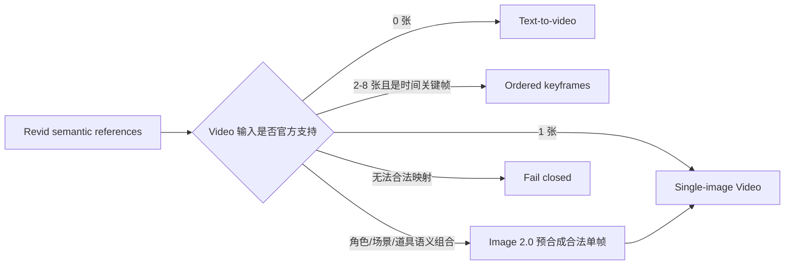

# Revid V3 可复用影视工作流模板 PRD

- Status: `APPROVED / V1 CONTRACT FROZEN`
- Version: `1.0`
- Date: `2026-07-28`
- Product owner: Human Owner
- Engineering owner: Codex / Revid Project Lead Engineer
- Canonical schema: `revid.workflow-template.v1`
- Contract artifacts: [`JSON Schema`](contracts/revid-workflow-template.v1.schema.json)、
  [`Behavior Matrix`](REVID-V3-WORKFLOW-TEMPLATE-BEHAVIOR-MATRIX.md) 与
  [`Normative Fixtures`](contracts/fixtures/workflow-template/)。
- Delivery boundary: Human Owner 已授权从 T6-017 连续推进到 T6-027；T6-013 已按真实证据关闭为
  `DONE / DEFERRED`。本批准只冻结 V1 产品与 contract defaults，不等于 T6-027 的 Human visual、interaction
  或 journey acceptance。

## 0. 文档结论

Revid 下一阶段应把已有 Canvas Graph Template 升级为一等的“可复用影视工作流模板”产品：用户选择模板、按需填写变量与绑定素材、完成 provider-free 预检，再通过现有 Canvas 原子 mutation 实例化为普通卡片和连接。实例化本身不调用模型、不扣 quota；用户编辑、确认后，才显式启动单卡或批量生成。

模板脚本必须是可版本化、可校验、无任意代码执行能力的声明式 manifest。它描述：

1. Graph skeleton；
2. typed variables 和素材槽位；
3. Script / Image / Video stages；
4. capability、费用和失败策略；
5. 可覆盖字段与锁定字段；
6. template、instance、step、node、asset 和 source revision lineage。

产品交互采用 clean-room 方法借鉴 LibTV 公开可观察的卡片信息层级、Workflow / Storyboard 双视图和 attached composer，但继续使用 Revid 自有品牌、文案、颜色、组件、图标、数据模型和交互实现。LibTV 未公开可观察的模板生命周期、group、多选、批量端口和 provider orchestration 均定义为 Revid-native 能力，不宣称 parity。

## 1. 背景与问题

### 1.1 当前项目已有的底座

| 领域 | 当前事实 | 可复用结论 |
|---|---|---|
| Graph Template | 已保存 `nodes + connections`，可捕获整个 Canvas，并原子实例化到现有或新建 Canvas | 保留为模板图落地的唯一 authority |
| Stable identity | 实例化会稳定 remap node、connection、group parent 和 edge endpoint，并支持 idempotent replay | 扩展 slot/binding，不另造图写入链路 |
| Story Production | 已有严格的角色、场景、道具、references、continuity 和 1～25 个 shots schema | 作为影视模板的标准中间表示 |
| Canvas mutation | typed command、history、autosave、revision conflict 和 recovery 已存在 | 模板配置和实例定制必须进入同一链路 |
| Generation | capability、quota、durable compact job、card-bound status/result 已有基础 | 模板只编排 intent，不直接调用 provider |
| Workflow UX | 已有 Workflow / Storyboard、card、attached surface、Script workspace、group、selection hull 等实现或 candidate | 实例化后继续表现为普通 Canvas 对象 |

### 1.2 当前缺口

当前 Template 只有名称和 Graph snapshot，实例化请求只有 `base_revision`、`client_mutation_id` 和可选 anchor。以下能力尚未成为产品 contract：

- typed variables、默认值、校验和可见条件；
- project asset slots 和 source revision policy；
- draft / published / retired 生命周期；
- immutable template version 与兼容迁移；
- template instance、step、node 和 output lineage；
- locked / allowed override policy；
- provider capability requirement 和费用预检；
- provider-free dry run；
- durable production orchestration；
- 对原 Project 的 asset ID、job ID、result URL、lineage 等不可移植字段的剥离；
- 团队或公开共享权限。

现有 `canvas-generation-batch` 是 mock-only Workflow Template，session storage 不是生产持久化权威。它的 dependency sort、preflight、quota estimate 和 fingerprint 可复用，但不得在产品或验收中被描述为真实 provider runner。

### 1.3 计划任务约束

| Task | 当前状态 | 对本文的含义 |
|---|---|---|
| T6-005 | `BLOCKED / FAIL` | 其视觉、交互、业务流和信息架构已被拒绝，只可作审计证据 |
| T6-012 | `BLOCKED / FAIL` | 只可选择性复用严格 Story contract；不把被拒绝的可见 Director 体验带回产品 |
| T6-013 | `DONE / DEFERRED` | Machine candidate 已提交；最终 Human journey acceptance 聚合到 T6-027 |
| 旧 T6-014～T6-016 | Superseded provisional scopes | 从未创建 formal Task，不伪造 DONE/FAIL/REPORT；能力分别由 T6-023、T6-024、T6-027 接管 |
| T6-017 | `DOING / PENDING` | 冻结本 PRD、schema、behavior matrix、cross-language contract 与 fixtures |

## 2. 产品愿景

让创作者把一次成功的“Brief → Script → 角色/场景/道具 → 分镜图片 → 视频”生产方法保存为模板，并在不同项目中安全复用；每次实例既可按需改编，又保留确定的拓扑、能力边界、版本和来源。

### 2.1 核心价值

- **复用方法，不复制脏状态**：保存拓扑、规则和可移植内容，不保存旧 job、旧 result URL 或越权 asset binding。
- **按需定制**：通过 typed slot、可编辑 prompt segment、素材绑定和允许的参数 override 完成定制。
- **先预检，后落地**：缺变量、素材越权、capability 不支持、依赖循环或 quota 不足时 fail closed。
- **实例化与执行分离**：建图零 provider call；执行必须由用户显式触发。
- **Provider truthfulness**：UI intent 与 provider payload 分层，不把产品层语义伪装成 Agnes 未公开支持的字段。
- **同一生产状态，两种视图**：Workflow 空间图和 Storyboard 生产板投影同一 canonical Canvas / Story state。

## 3. 目标用户与核心场景

### 3.1 用户

1. 独立短视频创作者：重复生产同类型短剧、广告或知识视频。
2. 影视/广告团队主创：固定品牌、角色一致性、画幅和镜头语言。
3. 模板作者：将验证过的工作方法封装、版本化并分发给项目成员。
4. 审阅者：在 Storyboard 视图检查文本、图片、视频和状态，但不改变图。

### 3.2 首批模板场景

- 15～60 秒商品广告；
- 单角色口播或知识短视频；
- 多镜头剧情短片；
- 角色设定与多视图资产；
- 首帧驱动的视频镜头；
- 首尾关键帧过渡镜头；
- 高信息密度海报或信息图；
- 从现有 Canvas 捕获并安全参数化的用户模板。

## 4. Goals 与 Non-goals

### 4.1 Goals

1. 支持内置模板和 user-owned 模板的创建、复制、版本化、预检、实例化和弃用。
2. 支持 text、number、boolean、enum、multiline、asset reference、bounded list 等 typed slot。
3. 支持 Script 镜头数量、画幅、风格、角色、场景、道具、Image size/count、Video 时长/清晰度/模式等按需定制。
4. 使用现有 Graph Template mutation 原子落地，保留 stable ID、history、autosave 和 revision。
5. 使用严格 Story Production 作为 Script 与下游生成的中间表示。
6. 支持 provider-valid 的 Agnes Text / Image / Video 编译、预检和 fail-closed。
7. 支持 Workflow / Storyboard 双视图和 same-card lifecycle。
8. 支持模板版本 lineage、实例脱离、兼容升级和本地 override 保护。
9. 明确安全、成本、quota、错误和人工确认边界。

### 4.2 Non-goals

- 不允许模板执行任意 JavaScript、Python、Shell、SQL 或远程代码。
- 不把模板实例化等同于运行；不自动产生付费调用。
- 不实现或承诺 Agnes 官方未公开的 semantic multi-image Video fusion。
- 不承诺独立 Audio Generation、配音或音轨控制；仅可播放 provider 最终视频自带音轨。
- 不暴露 Image / Video 2.5 Preview 为可运行模型。
- 不复制 LibTV 私有源码、DOM、网络协议、prompt、文案、品牌、字体、icon 或素材。
- 不新建第二套 Canvas renderer、graph store、history、autosave 或 provider pipeline。
- 本 PRD 不授权真实 provider call、付费行为、secret 访问或破坏性数据操作；T6-018 的 expand-first additive
  migration 仅按 Human Owner 的 program-level 指令和 database guard 执行。
- 不在首版支持 marketplace、计费分成或任意 public template 发布。

## 5. 锁定产品决策

1. 模板 schema ID 为 `revid.workflow-template`，首版 version 为 `1`。
2. Template Version immutable；修改已发布模板会创建新版本。
3. Template Instance 保存 exact `template_id + template_version`，不会静默跟随最新版。
4. 实例化只创建 Graph 和配置，不创建 provider job。
5. 用户点击单卡“生成”或显式 batch confirmation 后才开始执行。
6. Graph 落地只走现有 atomic Canvas document patch。
7. Template 不携带 job ID、provider task ID、result URL、quota ledger ID 或原项目私有 asset ID。
8. Project asset 必须通过 slot 重新绑定并做 owner、project、status 和 revision 校验。
9. 模板参数优先级固定为：

   `server-owned policy > template locks > template defaults > instance bindings > allowed local overrides`

10. 更新模板不得覆盖实例的 local override；用户必须显式选择保持、兼容升级、复制或脱离。
11. Built-in `revid.story-director` 为 project-owned、automatic、non-selectable；用户选择允许的文本模型，不选择 Director Skill。
12. Provider 请求 authority 是当前 backend capability / adapter contract，不是模板或 UI 字段。
13. Storyboard 是 canonical state 的只读/受控投影，不拥有第二份业务数据。
14. Mobile 375px 保持 review-only；模板编辑和图实例化只在支持编辑的 viewport 开放。
15. V1 scope 固定为 built-in + user-owned `private`，不含 team/public marketplace。
16. 首批 built-in 固定为 3 类：商品广告、知识/口播、多镜头剧情。
17. Private publish 形成 immutable version；compatible upgrade 必须显式确认。
18. V1 不做 import/export，不提供 `agnes-2.5-pro-alpha` selector。
19. Image 2.0 precomposition 只能由用户显式选择，不自动、不静默建议执行。
20. 成本只展示 backend-authoritative quota units + cost class，不硬编码货币金额。
21. 跨项目复用必须在 target project 重新绑定并验证 asset owner/project/status/revision。
22. Legacy Graph Template 保持可读；V3 persistence 和 runtime 采用 additive path。

## 6. 领域模型

### 6.1 七个一等对象

| 对象 | 职责 |
|---|---|
| `TemplateDefinition` | 稳定模板身份、owner、scope、类别和说明 |
| `TemplateVersion` | immutable graph、slots、steps、policy、schema 和 migration metadata |
| `TemplateSlot` | 用户按需填写的 typed variable 或素材占位 |
| `TemplateBinding` | 某实例对 slot 的值、asset、revision 和来源绑定 |
| `TemplateInstance` | 模板在某 Canvas 的落地记录和 stable node mapping |
| `WorkflowRun` | 用户显式启动后的 preflight、step 状态和 durable job lineage |
| `ProviderProjection` | 从 canonical intent 到特定 Agnes 请求的可版本化映射 |

### 6.2 生命周期

```text
draft -> published -> retired
  |          |
  +-> clone  +-> new immutable version
```

- `draft`：仅 owner 可见、可编辑，不可用于生产共享。
- `published`：版本 immutable，可被实例化。
- `retired`：已有实例继续可读，不再推荐新建。
- 删除仅允许无实例、无审计依赖的 draft；其余使用 retired。

### 6.3 实例状态

```text
configuring -> ready -> instantiated -> locally_modified
                         |                 |
                         +-> detached <----+
                         +-> upgrade_available
```

模板实例一旦落地，Canvas nodes 是普通 canonical nodes。实例记录只提供 lineage、升级差异和 slot 审计，不替代 Canvas graph authority。

## 7. 声明式模板脚本

### 7.1 安全语法

模板脚本使用 JSON manifest；编辑器可提供表单和 YAML-like 展示，但服务端只持久化规范化 JSON。允许：

- literal prompt segment；
- `variable` segment；
- `asset_reference` segment；
- bounded conditional；
- bounded repeat；
- typed dependency；
- capability predicate。

禁止：

- `eval`、函数、正则替换脚本、网络请求、文件路径、动态 import；
- 覆盖 server-owned system prompt；
- 访问未通过 slot 绑定的 Canvas 或 Project 数据；
- 使用模板变量拼接 provider endpoint、model ID 或认证头；
- 无界循环、递归或跨项目查找。

### 7.2 概念性 manifest 示例（non-normative）

本节仅说明结构，不是可执行 fixture。精确字段、required/optional、枚举和 fingerprint authority 是
[`revid-workflow-template.v1.schema.json`](contracts/revid-workflow-template.v1.schema.json) 与
[`portable-manifest.json`](contracts/fixtures/workflow-template/portable-manifest.json)；任何差异以前者为准。

```json
{
  "schema_id": "revid.workflow-template",
  "schema_version": 1,
  "template_id": "revid.product-ad",
  "template_version": 1,
  "lifecycle": "published",
  "metadata": {
    "name": "商品广告短片",
    "category": "commercial",
    "tags": ["product", "15-60s"],
    "description": "从商品 Brief 生成脚本、分镜图和可执行视频卡片"
  },
  "variables": [
    {
      "key": "product_name",
      "type": "text",
      "required": true,
      "label": "商品名称",
      "max_length": 120
    },
    {
      "key": "shot_count",
      "type": "integer",
      "required": true,
      "default": 6,
      "minimum": 1,
      "maximum": 25
    },
    {
      "key": "aspect_ratio",
      "type": "enum",
      "required": true,
      "default": "9:16",
      "options": ["16:9", "9:16", "1:1"]
    }
  ],
  "asset_slots": [
    {
      "slot_id": "product_reference",
      "media_type": "image",
      "role": "identity",
      "required": true,
      "minimum_items": 1,
      "maximum_items": 3,
      "revision_policy": "exact"
    }
  ],
  "graph": {
    "nodes": [
      {"local_id": "brief", "node_type": "text"},
      {"local_id": "script", "node_type": "script"},
      {"local_id": "images", "node_type": "generation", "subtype": "image"},
      {"local_id": "videos", "node_type": "generation", "subtype": "video"}
    ],
    "connections": [
      {"local_id": "brief-script", "from": "brief", "to": "script"},
      {"local_id": "script-images", "from": "script", "to": "images"},
      {"local_id": "images-videos", "from": "images", "to": "videos"}
    ]
  },
  "steps": [
    {
      "step_id": "compile-story",
      "node_local_id": "script",
      "intent": "story-production",
      "model_policy": "agnes-text-default",
      "input_bindings": ["product_name", "shot_count", "product_reference"]
    },
    {
      "step_id": "create-shot-images",
      "node_local_id": "images",
      "intent": "shot-image",
      "depends_on": ["compile-story"],
      "capability_requirements": ["image.text_or_image_input"]
    },
    {
      "step_id": "create-shot-videos",
      "node_local_id": "videos",
      "intent": "shot-video",
      "depends_on": ["create-shot-images"],
      "capability_requirements": ["video.text_or_single_image"]
    }
  ],
  "override_policy": {
    "allowed_fields": [
      "variables.*",
      "steps.create-shot-images.parameters",
      "steps.create-shot-videos.parameters"
    ],
    "locked_fields": [
      "schema_id",
      "graph.connections",
      "security",
      "provider.endpoint"
    ]
  },
  "result_policy": {
    "same_card": true,
    "image_batch_siblings": true,
    "ingest_provider_media": true
  },
  "security": {
    "arbitrary_code": false,
    "auto_execute": false,
    "cross_project_lookup": false
  }
}
```

### 7.3 Prompt document

Prompt 不使用不受控字符串正则替换，而使用有序 segment：

```json
[
  {"type": "literal", "value": "为以下商品编写短视频脚本："},
  {"type": "variable", "key": "product_name"},
  {"type": "literal", "value": "。目标镜头数："},
  {"type": "variable", "key": "shot_count"},
  {"type": "asset_reference", "slot_id": "product_reference"}
]
```

编译器必须：

1. 解析 slot；
2. 做类型、长度、owner、project 和 revision 校验；
3. 把 business metadata 编译成用户 prompt；
4. 附加 server-owned system/tool contract；
5. 输出 normalized request intent；
6. 在 provider adapter 中生成最终 Agnes payload。

## 8. 用户旅程

### 8.1 使用模板


详细规则：

1. 模板库展示名称、类别、version、slot 数、step 数、预计 quota 单位和 capability 状态。
2. 用户先查看拓扑预览，不立即向 Canvas 写入。
3. 配置 drawer 只显示该模板声明的可编辑项。
4. `预检` 不创建 provider task、job、quota reservation 或 Canvas mutation。
5. 预检通过后，用户点击“添加到画布”。
6. backend 在一个 Canvas document patch 中插入全部 nodes、connections 和 instance lineage。
7. 用户继续使用普通卡片编辑、移动、连线、group、rename、undo/redo。
8. 用户显式点击生成；系统再次做 runtime capability/quota/cost preflight。
9. Durable job 在浏览器刷新后继续，结果回到 owning stable card。

### 8.2 从当前 Canvas 创建模板

1. 用户框选 Graph 或选择一个 Storyboard group。
2. 系统列出不可移植字段：
   - project asset；
   - generation job / provider task；
   - result URL；
   - quota / ledger；
   - source revision；
   - user-specific local path。
3. 用户将可复用引用提升为 asset slot，把普通值提升为 variable，或明确删除。
4. 系统生成 draft manifest，并做 graph、port、slot 和 security validation。
5. 用户填写 metadata、默认值和 override policy。
6. 发布后形成 immutable version 1；后续修改创建新 version。

### 8.3 版本升级

用户打开旧实例时可看到：

- 当前 template/version；
- 最新 compatible version；
- graph、slot、policy 和 provider requirement diff；
- local overrides 和无法自动迁移项。

可选动作：

1. 保持当前实例；
2. 应用兼容升级；
3. 复制为独立模板；
4. 脱离模板继续编辑。

升级必须是一个可 undo 的 typed command，并要求 `base_revision`。不允许静默升级。

## 9. Canvas UI 与交互需求

### 9.1 Clean-room 设计边界

允许借鉴公开可观察的：

- Workflow / Storyboard 顶部切换；
- media-first card 层级；
- 外置 title / metadata；
- selected card attached composer；
- 添加节点菜单；
- card-local generation lifecycle；
- Storyboard 的 Text / Image / Video 生产分栏；
- reference thumbnail 和 source indicator。

必须由 Revid 独立定义的：

- 模板库、slot 配置、version lifecycle 和 upgrade；
- marquee、多选 hull、group/ungroup 和 batch continuation；
- template preflight、atomic instantiate 和 durable orchestration；
- 文案、颜色、图标、动效、DOM、数据 contract 和 provider mapping。

### 9.2 双视图

#### Workflow

- 空间 Graph 为完整编辑 authority。
- 卡片和 edge 继续使用 canonical node / connection。
- 模板实例不创建“模板专用卡”；只通过低噪音 lineage badge 表示来源。
- Toolbar 支持 Add Node、move、asset、history、shortcut、zoom、arrange 和 edge visibility。
- 模板节点可像普通节点一样 rename、move、connect、group 和 delete。

#### Storyboard

- 从同一 Canvas / Story Production 投影，不复制业务数据。
- 首版 lanes：
  - Key Elements：角色、场景、道具和参考；
  - Text：Brief、Script、shot rows；
  - Image：按 shot / group 展示预览、状态和 reference；
  - Video：按 shot / group 展示预览、model/version、reference 和状态。
- Storyboard 默认用于审阅、排序和受控编辑，不直接拥有 provider orchestration。
- 从 Storyboard 选择条目必须定位同一 stable Canvas node。

### 9.3 Card

- Resting card 只显示外部 identity、主要文本/媒体和最小 lifecycle。
- Image / Video 的 media 是 card body；成功后替换 placeholder，不创建隐藏 Result 卡。
- Script resting card 保持紧凑，结构化表格通过 full-screen workspace 展开。
- Selection 只增强同一 card，并显示一个 attached toolbar。
- queued / running / persisting 使用唯一 card-bound loading authority。
- failed 只显示一个 card-local error authority，保留可操作 retry。
- 技术 ID、raw provider response、完整 prompt 和 secret 不进入正常 chrome。

### 9.4 Attached composer

一个 active card 只能有一个 composer，层级固定为：

1. mode / source actions；
2. prompt 和 reference tokens；
3. model / parameters / quota / status；
4. terminal submit。

Composer 规则：

- deselect 只隐藏，不清空 persisted configuration；
- reference 使用 stable node ID、asset ID、source revision、role 和 order；
- 断开 persisted edge 通过 typed mutation 删除对应 reference；
- unsupported model/mode/parameter 明确 disabled，并解释原因；
- submit 前展示预计 quota / cost class；
- mobile review-only 不显示编辑 composer。

### 9.5 Template Library 与配置 drawer

模板库包含：

- Built-in；
- My Templates；
- Recent；
- Deprecated。

模板卡展示：

- name、category、version、owner；
- required slots；
- node/step 数；
- supported viewport；
- capability readiness；
- 是否含付费 model gate；
- 更新时间和 deprecation。

配置 drawer 展示：

- 表单化 variables；
- asset slots；
- Script 镜头数；
- Image / Video capability-authoritative 参数；
- locked 与可覆盖字段；
- graph preview；
- preflight 错误；
- quota estimate；
- “添加到画布”主操作。

## 10. Script 生产需求

### 10.1 Story Director

- Built-in `revid.story-director` 自动工作，不在 Add Node / Skill Picker 中出现。
- 默认文本模型为当前 capability 允许的 `agnes-2.5-flash`。
- `agnes-2.0-flash` 可作为兼容 fallback。
- `agnes-2.5-pro-alpha` 仅在账户 capability、费用提示和用户显式授权后开放。
- 官方文本模型支持 tool calling；Revid 优先使用 server-owned `submit_revid_storyboard` tool contract。
- Agnes 文本模型页未公开 native JSON Schema / `response_format` 请求字段，因此不得自行发送。
- provider output 必须经过 strict parser、Story Production schema 和最多一次 bounded repair。
- invalid output 保留上一份 validated Script，展示安全错误分类，不泄露 raw provider output。

### 10.2 Structured Script workspace

工作区至少支持：

- 镜号；
- 时长；
- 画面描述；
- 景别；
- 光影氛围；
- 对白/旁白；
- 音效；
- 运镜；
- Image prompt；
- Video prompt；
- 确认状态与操作。

资产面板包含 role、scene、prop 和 references。所有实体在首次落地后使用 immutable local ID；后续编辑或 partial regeneration 按 target ID 合并，不再根据可编辑名称/描述重新推导身份。

### 10.3 Confirm 与下游卡片

流程：

1. 确认 shots；
2. 编辑和确认 role / scene / prop；
3. 确认 prompts；
4. 选择 shots；
5. 创建 Image 或 Video Generation cards；
6. 不自动生成。

批量创建必须走一个 atomic `insert-graph` typed command，保存 `source_script_node_id`、`shot_id`、`shot_index`、template instance lineage 和参数 snapshot。

## 11. Agnes 官方模型映射

本节以 2026-07-28 的 Agnes 官方页面为 snapshot。运行时仍以 backend capability 和 versioned adapter 为权威，文档变化必须触发 contract review。

### 11.1 Text

| 模型 | Revid 用途 | 公开 contract | 产品策略 |
|---|---|---|---|
| `agnes-2.0-flash` | 兼容 fallback | `POST /v1/chat/completions`，支持 messages、tools、image URL、stream | 非默认 |
| `agnes-2.5-flash` | Script、改写、镜头拆分、图像理解 | 与 2.0 兼容，面向 coding、Agent、tool、多模态升级 | 默认 |
| `agnes-2.5-pro-alpha` | 复杂长上下文任务 | 1M context、付费、需账户权限 | capability + cost + Human gate |

要求：

- backend 持有 API key，前端不得接触；
- 模板只声明 model policy，不持久化 endpoint 或 token；
- structured output 使用 tool / application contract + strict validation；
- 不发送官方未公开的 `response_format`。

### 11.2 Image

| 模型 | 官方能力 | Revid 策略 |
|---|---|---|
| `agnes-image-2.0-flash` | text-to-image、image-to-image、明确支持 multi-image composition | 多参考合成的合法预合成阶段 |
| `agnes-image-2.1-flash` | text-to-image、image-to-image、高信息密度；`1K/2K/3K/4K` 与官方 ratio 表 | 默认高质量 Shot Image |

Adapter 要求：

- endpoint：`POST /v1/images/generations`；
- image input 使用 `extra_body.image`；
- `response_format` 使用 `extra_body.response_format`；
- 不发送旧式 `tags: ["img2img"]`；
- provider 返回的实际 dimensions 为结果 authority；
- Image 2.1 文档未明确承诺 multi-image composition，开放前必须有独立 capability / live contract 证据；
- 每图 `role`、`instruction`、`must_not_transfer` 是 Revid business metadata，可编译入 prompt，但不得宣称 provider typed enforcement；
- 2.5 Preview 不进入 runnable catalog。

### 11.3 Video

唯一当前专用 API 模型为 `agnes-video-v2.0`：

- 创建：`POST https://apihub.agnes-ai.com/v1/videos`；
- 推荐查询：`GET https://apihub.agnes-ai.com/agnesapi?video_id=<VIDEO_ID>`；
- legacy 查询：`GET /v1/videos/<TASK_ID>`；
- statuses：`queued`、`in_progress`、`completed`、`failed`；
- 完成 URL：`metadata.url`；
- actual `size` / `metadata.size_mapping` 为结果 authority。

公开输入模式仅有：

1. text-to-video；
2. 顶层单图 `image` 的 image-to-video；
3. `extra_body.image[] + extra_body.mode="keyframes"` 的有序关键帧。

可选请求包括 width、height、`num_frames`、`frame_rate`、seed 和 `negative_prompt`。`num_frames` 必须 `<= 441` 且满足 `8n+1`。

### 11.4 Provider-valid 多参考视频策略

Agnes Video 当前没有公开“角色图 + 场景图 + 道具图”的 semantic multi-image fusion，也没有每图 role / instruction / exclusion 字段。因此 T6-024 必须替代旧 T6-015 provisional scope：



规则：

- Revid 可保留 stable node/asset ID、source revision、business role、instruction、exclusion 和 order。
- 只有合法 frame role 进入 Agnes Video image binding。
- identity / scene / prop metadata 只能作为 continuity / prompt context。
- 需要组合时，先用 Image 2.0 生成一张 Revid-owned composed frame，再作为单图输入 Video。
- 不允许把 semantic references 静默重解释为 keyframes。
- 官方当前参数表未列出 top-level `resolution`；产品“清晰度”默认映射为 capability-authoritative width/height。只有 versioned provider contract 明确支持时才发送 `resolution`。
- 无 cancel endpoint、provider idempotency 或永久 URL 保证；Revid 必须持久化 opaque `video_id`、避免重复 submit，并把完成媒体摄取到自有 asset storage。

### 11.5 Audio 边界

官网宣传可能描述音视频同步，但 Video V2.0 API 页没有独立音频输入、配音、音轨选择或 Audio Generation endpoint。产品只能：

- 播放 provider MP4 内已有音轨；
- 在 capability 不存在时隐藏/禁用 Audio Generation；
- 不承诺配音、音轨混合或独立音频模型。

## 12. Provider compilation pipeline

```text
Template + Instance Bindings
  -> strict manifest validation
  -> graph/asset/capability/quota preflight
  -> normalized Revid Intent
  -> provider-specific projection
  -> exact request schema validation
  -> durable job submit
  -> bounded polling / runner
  -> owned asset ingestion
  -> same-card result projection
```

每一层必须可独立测试。Template compiler 不可直接发 HTTP；provider adapter 不可直接修改 Canvas。

## 13. Backend 需求

### 13.1 Schema / services

新增或扩展：

- `TemplateDefinition`；
- `TemplateVersion`；
- `TemplateVariable`；
- `TemplateAssetSlot`；
- `TemplateInstance`；
- `TemplateInstanceBinding`；
- `TemplateInstanceStep`；
- `TemplatePreflightResult`。

所有新表/字段如最终确需 migration，必须走独立 expand-first Task、添加非空 comment 并取得 Human authorization。本 PRD 不授权 migration。

### 13.2 API 草案

```text
GET    /api/workflow-templates
POST   /api/workflow-templates
GET    /api/workflow-templates/{template_id}/versions/{version}
POST   /api/workflow-templates/{template_id}/versions
POST   /api/workflow-templates/{template_id}/versions/{version}/publish
POST   /api/workflow-templates/{template_id}/versions/{version}/preflight
POST   /api/projects/{project_id}/canvases/{canvas_id}/workflow-template-instances
GET    /api/projects/{project_id}/canvases/{canvas_id}/workflow-template-instances/{instance_id}
POST   /api/projects/{project_id}/canvases/{canvas_id}/workflow-template-instances/{instance_id}/upgrade-preflight
POST   /api/projects/{project_id}/canvases/{canvas_id}/workflow-template-instances/{instance_id}/detach
```

实例化请求至少包含：

```json
{
  "template_id": "revid.product-ad",
  "template_version": 1,
  "base_revision": 42,
  "client_mutation_id": "uuid",
  "anchor": {"x": 120, "y": 80},
  "variable_bindings": {},
  "asset_bindings": {},
  "preflight_fingerprint": "sha256"
}
```

### 13.3 Atomicity 与 idempotency

- preflight 生成 canonical fingerprint；
- instantiate 重验 fingerprint、base revision、owner 和 slot revision；
- Graph + instance lineage 在一个 transaction / Canvas patch 中提交；
- 同一 `client_mutation_id` 重试返回同一 node/connection ID map；
- 任一 slot、port、capacity 或 revision 失败时零部分写入；
- template version 在实例化开始后不可改变。

### 13.4 Portable / non-portable classifier

保存模板时必须分类：

| 类型 | 处理 |
|---|---|
| 普通文字、合法参数、layout | 可移植 |
| node / connection local ID | 保存为 template local ID，实例化 remap |
| project asset | 提升为 asset slot |
| source revision | 绑定时重验 |
| generation job / provider task | 删除 |
| result URL / base64 | 删除 |
| quota / ledger | 删除 |
| owner/user ID | 不进入模板内容 |
| private prompt/system contract | 只保存 server-owned reference |

## 14. Frontend 需求

### 14.1 Domain ownership

- `modules/template` 扩展 definition/version/slot/instance types 和 API。
- Template feature orchestrator 负责 library、preflight、instantiate 和 upgrade。
- Canvas components 只接收 presentation-ready state 并 emit intent。
- 参数应用走现有 typed command / autosave；不得 localStorage-only。
- Workflow batch mock controller 不升级为生产 authority；生产 run 使用 durable backend job。

### 14.2 Validation UX

错误按层显示：

- slot missing；
- asset forbidden / inactive / revision drift；
- graph/port invalid；
- unsupported capability；
- quota/cost insufficient；
- dependency cycle；
- template version unavailable；
- stale Canvas revision；
- provider unavailable；
- malformed provider result。

错误文案必须可操作、中文、安全；不显示 raw Axios、provider body、secret、内部 SQL 或 stack trace。

### 14.3 Accessibility / responsive

- 全部模板表单有 label、description、error association。
- keyboard 可完成 template selection、slot binding、preflight、instantiate。
- focus 在 modal/drawer 关闭后返回 opener。
- reduced-motion 保留可见状态，不强制动画。
- 1440、1366、920 宽度可完整使用；375px review-only。
- screen reader 可识别 template version、slot completion、preflight result 和 lifecycle。

## 15. Preflight contract

Preflight 必须是纯检查，不产生副作用。输出：

```json
{
  "contract_version": 1,
  "template": {"id": "revid.product-ad", "version": 1},
  "executable": false,
  "errors": [],
  "warnings": [],
  "resolved_slots": [],
  "graph_summary": {"nodes": 4, "connections": 3},
  "capability_snapshot": {"version": 7},
  "quota_estimate": {"text": 1, "image": 6, "video": 6},
  "cost_class": "requires_confirmation",
  "fingerprint": "sha256"
}
```

Preflight 检查顺序：

1. schema / version；
2. owner / scope；
3. variable type / bounds；
4. asset owner / project / status / revision；
5. graph capacity / ports / cycle；
6. model / mode / parameter capability；
7. quota estimate；
8. cost / permission；
9. fingerprint。

## 16. 执行与生命周期

### 16.1 Step state

```text
draft -> ready -> submitting -> queued -> running -> persisting
                                      \-> failed
                         persisting -> succeeded
```

`completed` provider status不等于 card succeeded。只有 exact result 获取、owned asset ingestion 和同卡 media materialization 完成后，card 才显示 success。

### 16.2 Batch

- batch 只是对独立 step/card job 的显式编排；
- 每个 image output slot 有独立 stable card / sibling、job、asset 和 retry；
- mixed success 保留；
- retry 是 card-local；
- dependency 未满足的 step 标记 blocked，不伪装 failed；
- batch cancel 仅在 backend/provider contract 支持时开放；
- browser close / refresh 不终止 durable run。

## 17. 安全、隐私与成本

1. API key 仅由 backend process environment 使用，禁止进入模板、前端、日志、截图和错误。
2. 模板 manifest 不允许 endpoint、header、token、local path 或任意代码。
3. asset slot 必须 owner / project scoped，禁止跨用户引用。
4. provider 原始响应不进入 Canvas document 或 template。
5. prompt、source content 和 provider result 只保存完成业务所需的 bounded/sanitized 数据。
6. paid model 或费用级别变化必须显示 preflight，并要求显式确认。
7. rate limit 不能硬编码为永久产品事实；运行时由 capability / account authority 提供。
8. duplicate protection 由 Revid idempotency 负责，不能假设 provider 支持。
9. result URL 视为临时，完成后摄取到 Revid-owned storage。
10. public/team sharing 留到单独授权与安全设计 Task。

## 18. Failure policy

| 场景 | 行为 |
|---|---|
| 模板 version 不支持 | 阻止实例化，提示复制或迁移 |
| required slot 缺失 | 聚焦该字段，零 mutation |
| asset 越权/失效 | 阻止并要求重新绑定 |
| source revision 漂移 | 展示旧/新 revision，要求确认 |
| provider capability 不支持 | 禁用组合并解释；不降级成不同语义 |
| Video semantic multi-reference | 预合成合法单帧或 fail closed |
| quota 不足 | 阻止执行，不影响已实例化 Graph |
| duplicate submit | 返回现有 durable job / replay |
| provider 409/429/503/timeout | 按错误类别 bounded retry；不重复扣费 |
| malformed Script | 保留上一 validated state，最多一次 repair |
| terminal URL 获取失败 | card 保持 result-applying / retryable |
| Canvas revision 409 | 保留本地配置，走现有 conflict/recovery |

## 19. 验收标准

### 19.1 Template contract

1. 同一 published version 内容 immutable。
2. invalid extra field、未知 slot type、任意代码字段均 fail closed。
3. 模板不含 job、provider task、result URL、quota ledger 或 owner secret。
4. 同一 canonical manifest 序列化产生稳定 fingerprint。

### 19.2 Instance

5. 同一模板实例化两次，逻辑拓扑一致，Canvas entity IDs 完全隔离。
6. 同一 `client_mutation_id` 重试返回相同 ID map，且没有重复节点。
7. 缺 required variable / asset slot 时 Canvas 零部分写入。
8. 跨用户、跨项目、inactive asset 和 revision drift 均被拒绝。
9. graph、group parent 和 edge endpoint remap 正确。
10. instance 保存 template/version/step/node lineage。
11. 模板实例化零 provider request、零 quota mutation、零 provider job。

### 19.3 Customization

12. typed variable 的默认值、范围、enum 和长度校验一致。
13. 参数定制通过 typed command，可 undo/redo，并经 autosave/reload 恢复。
14. locked field 不可编辑；allowed override 可编辑且不会被升级静默覆盖。
15. 用户可保持、兼容升级、复制或脱离实例。

### 19.4 Script / Image / Video

16. Story Director 自动且不可选择，输出必须通过 strict Story Production。
17. Script 实体首次落地后保持 immutable local ID。
18. 选中 shots 创建下游 Image/Video cards，但不自动生成。
19. Image 2.0 多图合成、Image 2.1 单图/文生图按各自 capability 开放。
20. Video 只发送 text、single image 或 ordered keyframes。
21. semantic character/scene/prop multi-reference 不进入 Video payload。
22. product clarity 映射为 width/height；无 contract evidence 时不发送顶层 `resolution`。
23. provider actual dimensions 和 result metadata 为结果 authority。
24. completed media 摄取到 owned asset 并投影到同一 stable card。

### 19.5 UX / quality

25. Workflow / Storyboard 定位同一 stable node，切换不丢 selection、camera 或 state。
26. Template drawer keyboard / screen reader 可用。
27. 1440、1366、920 无不可达主操作；375 为 review-only。
28. no raw provider、Axios、secret 或 stack trace。
29. focused unit/contract/browser tests、relevant regression、fresh build、security diff 和 Human visual/interaction gate 全部完成后，才可宣称交付。

## 20. 成功指标

首版目标指标：

- 模板配置到成功实例化的完成率；
- required slot 首次通过率；
- preflight 失败分类分布；
- 模板实例化 p95；
- duplicate / partial-write 数量必须为 0；
- 实例化后进入首次显式生成的转化；
- Script → Image → Video 完成率；
- provider-invalid payload 数量必须为 0；
- same-card result materialization 成功率；
- 模板版本升级失败率；
- 用户主动脱离模板比例；
- Human acceptance 中的阻断级 UI / interaction defect 数。

不得使用的虚假指标：

- 以 mock run 代替 provider success；
- 以 provider `completed` 代替 owned asset / same-card success；
- 以机器 screenshot 代替 Human visual acceptance；
- 以生成调用次数作为创作质量。

## 21. 交付切片与依赖

### Phase A — Contract freeze

- 本 PRD Human approval；
- `revid.workflow-template.v1` JSON Schema；
- portable / non-portable classifier；
- preflight fixtures；
- provider mapping fixtures；
- security abuse cases。

依赖：T6-013 已按 program-level authorization 和真实 machine evidence 正式关闭为 `DONE / DEFERRED`；
最终 Human journey acceptance 聚合到 T6-027。

### Phase B — Parameterized Template core

- definition/version/slot/instance domain；
- user-owned draft / publish / deprecate；
- capture → parameterize；
- provider-free preflight；
- atomic instantiate；
- lineage / detach。

### Phase C — Canvas UX

- Template Library；
- configuration drawer；
- Workflow / Storyboard unified projection；
- instance badge / diff / upgrade；
- responsive / accessibility。

### Phase D — Script / Image integration

- template-aware Story Director request lineage；
- stable Story Production merge；
- selected-shot card creation；
- T6-023 完整收口旧 T6-014 provisional same-card Image / batch sibling lifecycle。

### Phase E — Provider-valid Video

- T6-024 替代旧 T6-015 provisional scope；
- semantic metadata 与 provider frame binding 分层；
- Image 2.0 precomposition；
- single-image / keyframe Video；
- unsupported fusion fail closed。

### Phase F — Compatibility retirement

- T6-027 完成旧 T6-016 provisional compatibility retirement；
- 移除 legacy full-task payload、project-wide polling 和 hidden Result coupling；
- migration / cleanup 另行授权；
- full Human visual、interaction、journey acceptance。

## 22. Human 已决策的 V1 defaults

T6-017 冻结以下选择，后续任务不得重新打开这些歧义：

1. scope 为 built-in + user-owned `private`，不含 team/public；
2. private publish 无审核队列，发布后 version immutable；
3. 首批 built-in 为 3 类；
4. V1 不提供 `agnes-2.5-pro-alpha` selector；
5. compatible upgrade 只允许 additive-compatible 变更，并由用户显式确认，不覆盖 local override；
6. V1 不做模板 import/export；
7. Image 2.0 precomposition 只能显式选择，不自动执行；
8. quota estimate 展示 backend-authoritative 单位和 cost class，不接入或硬编码货币金额。

## 23. PRD 复用说明

将本文复用于其他模板类需求时，只需替换：

- 产品场景与模板种子；
- typed variables / asset slots；
- graph skeleton；
- Story Production profile；
- provider capability matrix；
- override policy；
- quota/cost policy；
- acceptance fixtures。

以下 contract 不应随模板变化：

- no arbitrary code；
- no auto provider call；
- atomic Canvas mutation；
- stable identity；
- owner/project/revision validation；
- typed command/history/autosave；
- provider truthfulness；
- version lineage；
- same-card result；
- Human acceptance boundary。

## 24. 官方与项目来源

### Agnes 官方文档

- [Agnes 概述](https://agnes-ai.com/zh-Hans/docs/overview)
- [Agnes 2.0 Flash](https://agnes-ai.com/zh-Hans/docs/agnes-20-flash)
- [Agnes 2.5 Flash](https://agnes-ai.com/zh-Hans/docs/agnes-25-flash)
- [Agnes 2.5 Pro Alpha](https://agnes-ai.com/zh-Hans/docs/agnes-25-pro-alpha)
- [Agnes Image 2.0 Flash](https://agnes-ai.com/zh-Hans/docs/agnes-image-20-flash)
- [Agnes Image 2.1 Flash](https://agnes-ai.com/zh-Hans/docs/agnes-image-21-flash)
- [Agnes Video V2.0](https://agnes-ai.com/zh-Hans/docs/agnes-video-v20)
- [Agnes Token Plan](https://agnes-ai.com/zh-Hans/docs/tokenplan)
- [Agnes 常见错误码](https://agnes-ai.com/zh-Hans/docs/code)

### 项目权威

- `ai/state/CURRENT.md`
- `ai/state/ROADMAP.md`
- `ai/architecture/REVID-T6-006-FULL-STACK-MODULAR-REFACTOR.md`
- `ai/architecture/REVID-V2-CANVAS-ARCHITECTURE.md`
- `ai/requirements/T6-011-HUMAN-CONFIRMED-CANVAS-CARD-INTERACTION-CONTRACT.md`
- `ai/requirements/T6-011-HUMAN-DIRECTED-CANVAS-FRONTEND-REPLACEMENT.md`
- `ai/tasks/todo/TASK-T6-013.md`
- `ai/tasks/doing/TASK-T6-013-PLAN.md`
- `ai/tasks/doing/TASK-T6-013-PROGRESS.md`
- `ai/reports/REPORT-T6-003.md`
- `ai/reports/REPORT-T6-004.md`
- `ai/reports/REPORT-T6-006.md`
- `ai/reports/REPORT-T6-007.md`
- `ai/reports/REPORT-T6-008.md`
- `ai/reports/REPORT-T6-009.md`
- `ai/reports/REPORT-T6-010.md`
- `ai/reports/REPORT-T6-011.md`

### Clean-room 声明

LibTV 相关需求来自其公开可观察界面、现有项目 clean-room evidence 和 Human-confirmed Revid contract。本文没有使用、复制或要求获取 LibTV 私有源码、内部网络 contract、隐藏 prompt、品牌资产或专有素材。所有实现必须继续保留可审计的独立设计证据。
